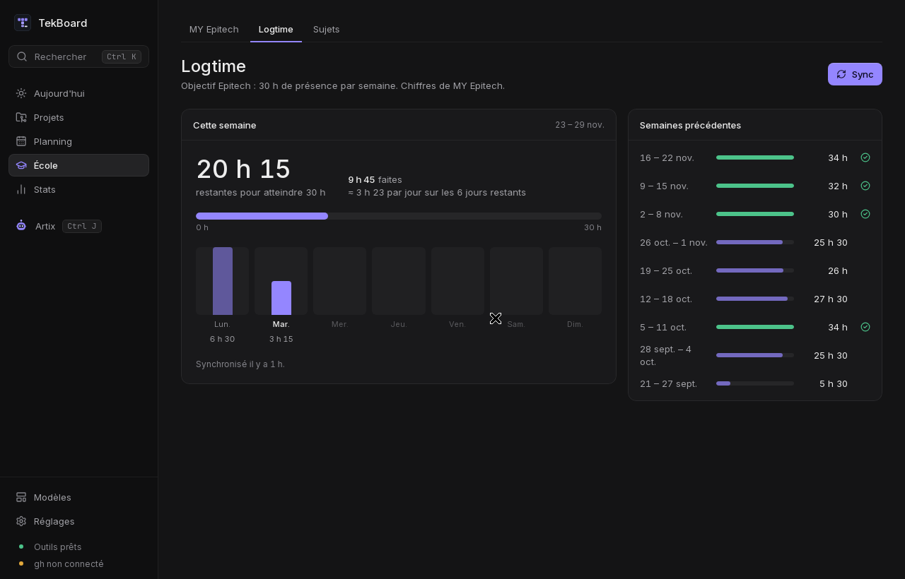
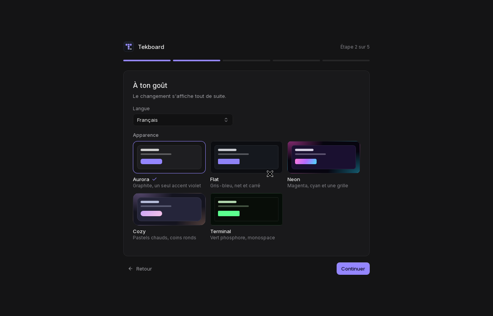
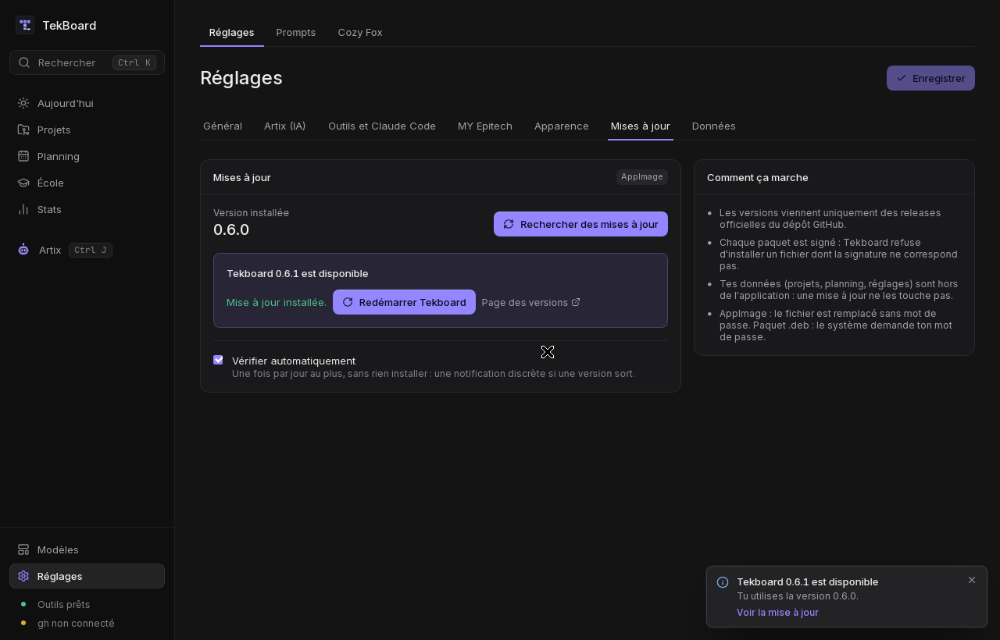
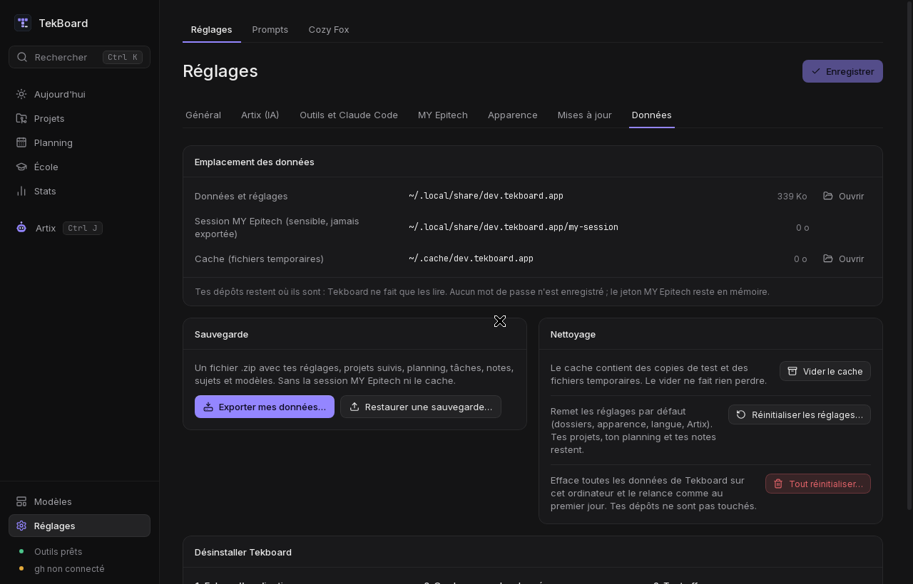

<p align="center"></p>

<h1 align="center">TekBoard</h1>

<p align="center">Ton tableau de bord d'étudiant Epitech, sur Linux.<br/>Tes projets, tes rendus, ton planning, ton logtime et Artix, un assistant qui agit pour toi.</p>

<p align="center"><a href="https://github.com/ar-oxyo/tekboard-desktop/releases/latest"><b>Télécharger la dernière version</b></a></p>


## Ce que fait Tekboard

- **Projets** : tous tes dépôts Epitech au même endroit, avec leur état git, leur date de rendu et ce qu'il reste à faire. Les copies en double se masquent ou s'archivent.
- **Planning** : un calendrier qui place tes sessions de travail avec des pauses, des catégories à toi, et les rendus de l'école.
- **École** : synchronisation MY Epitech en un bouton (projets, dates, sujets, résultats), **logtime** de la semaine avec ce qu'il reste sur les 30 h.
- **Tests** : tests unitaires, coding style (Banana), clone propre du dépôt, et une moulinette simulée dans un bac à sable.
- **Artix** : un assistant (Claude Code) qui comprend « j'ai un rendez-vous jeudi à 14 h » et l'ajoute, décompose un sujet en tâches, organise ta semaine. Il demande confirmation avant tout changement important.

Tout reste sur ton ordinateur : pas de compte, pas de serveur, pas de télémétrie.

| | |
| --- | --- |
|  |  |
|  |  |

## Installer

Tekboard fonctionne sur **Linux 64 bits** (x86_64). Il n'existe pas de version macOS ni Windows.

### Ubuntu, Debian, Linux Mint, Pop!_OS (recommandé)

1. Ouvre la [dernière version](https://github.com/ar-oxyo/tekboard-desktop/releases/latest) et télécharge **`TekBoard_<version>_amd64.deb`**.
2. Double-clique sur le fichier : l'App Center (ou « Logiciels ») s'ouvre.
3. Clique sur **Installer** et entre ton mot de passe.

Tekboard apparaît ensuite dans la liste de tes applications. Les bibliothèques nécessaires sont installées avec lui.

<details>
<summary>Si le double-clic ouvre le fichier comme une archive</summary>

Clic droit sur le fichier → **Ouvrir avec** → **App Center** (ou **Installation de logiciels**). À défaut, dans un terminal : `sudo apt install ./TekBoard_*_amd64.deb`.
</details>

### Autres distributions (Fedora, Arch, openSUSE…)

1. Télécharge **`TekBoard_<version>_amd64.AppImage`** depuis la [dernière version](https://github.com/ar-oxyo/tekboard-desktop/releases/latest).
2. Clic droit → **Propriétés** → coche **Autoriser l'exécution comme programme** (ou `chmod +x TekBoard_*.AppImage`).
3. Double-clique dessus.

Il faut WebKitGTK 4.1 (présent sur les bureaux GNOME et KDE récents) et, sur certaines distributions, FUSE 2 (`libfuse2`).

### Vérifier le téléchargement (facultatif)

Chaque version est accompagnée de `SHA256SUMS` et d'une attestation de provenance GitHub :

```sh
sha256sum -c SHA256SUMS --ignore-missing
gh attestation verify TekBoard_*_amd64.deb -R ar-oxyo/tekboard-desktop
```

## Premier lancement

Un court assistant te guide (chaque étape facultative se passe) :

1. **Langue et apparence** (français ou anglais, cinq designs), appliquées tout de suite.
2. **MY Epitech** : tu te connectes sur le vrai site, dans une fenêtre à part. Tekboard ne voit jamais ton mot de passe. Étape facultative.
3. **Tes dossiers de projets** : Tekboard propose ceux où il trouve des dépôts git. Il ne fait que les lire.
4. **C'est prêt.**

Tu peux fermer Tekboard au milieu : il reprend à la même étape. L'assistant se relance depuis **Réglages → Général**.

Outils facultatifs, utilisés quand ils sont là : `gh` (liste de tes dépôts GitHub), [Claude Code](https://claude.com/claude-code) (Artix), `bubblewrap` (moulinette et génération de tests en bac à sable), `valgrind`, `epiclang` et `banana-check-repo`. **Réglages → Outils** montre ce qui est détecté.

## Mettre à jour

Tekboard cherche lui-même une nouvelle version une fois par jour au plus, et te prévient par une petite notification. Tu peux aussi aller dans **Réglages → Mises à jour → Rechercher des mises à jour**.

- **AppImage** : **Installer la mise à jour** remplace le fichier, sans mot de passe.
- **Paquet .deb** : même bouton ; le système demande ton mot de passe, puisqu'il s'agit d'un paquet système.
- Puis **Redémarrer Tekboard**.

Chaque paquet est signé : Tekboard refuse un fichier dont la signature ne correspond pas. Tes données ne sont jamais touchées par une mise à jour. La vérification automatique se désactive dans le même écran.

## Désinstaller

- **Paquet .deb** : App Center → **Applications installées** → TekBoard → **Désinstaller** (ou `sudo apt remove tek-board`).
- **AppImage** : supprime le fichier.

Désinstaller **garde tes données** : si tu réinstalles, tu retrouves tout. Pour tout effacer, va d'abord dans **Réglages → Données → Tout réinitialiser…**, puis désinstalle. Tes dépôts et tes dossiers de projets ne sont jamais supprimés.

## Tes données

| Quoi | Où |
| --- | --- |
| Réglages, projets suivis, planning, tâches, notes | `~/.local/share/dev.tekboard.app/tekboard.db` |
| Sujets téléchargés, modèles, bibliothèques | `~/.local/share/dev.tekboard.app/` |
| Session MY Epitech (cookies du site) | `~/.local/share/dev.tekboard.app/my-session/` |
| Fichiers temporaires | `~/.cache/dev.tekboard.app/` |

**Réglages → Données** permet d'ouvrir ces dossiers, d'**exporter** une sauvegarde (.zip), de la **restaurer** sur un autre ordinateur, de vider le cache et de réinitialiser. La sauvegarde ne contient ni la session MY Epitech ni aucun mot de passe. Voir aussi [SECURITY.md](SECURITY.md).

## Signaler un bug

[Ouvre un ticket](https://github.com/ar-oxyo/tekboard-desktop/issues/new/choose) en indiquant ta version (**Réglages → Mises à jour**), ton format d'installation et ta distribution. Une faille de sécurité se signale en privé : voir [SECURITY.md](SECURITY.md).

## Développer

Il faut Node.js 20+, Rust (<https://rustup.rs>) et les bibliothèques système :

```sh
sudo apt install libwebkit2gtk-4.1-dev libgtk-3-dev librsvg2-dev \
  libayatana-appindicator3-dev libssl-dev pkg-config build-essential
npm ci
npm run app:dev      # application avec rechargement à chaud
npm test             # tests du frontend
npm run test:rust    # tests du backend
```

`./scripts/install.sh` compile et installe le `.deb` depuis un clone, en demandant avant chaque étape `sudo`. L'architecture est décrite dans [docs/ARCHITECTURE.md](docs/ARCHITECTURE.md).

**Publier une version** (mainteneurs) : mets la version à jour dans `package.json`, `src-tauri/Cargo.toml` et `src-tauri/tauri.conf.json`, ajoute sa section dans [CHANGELOG.md](CHANGELOG.md) (`npm run release:check` vérifie le tout), puis pousse un tag `vX.Y.Z`. Le workflow `release.yml` compile, signe et prépare une release **brouillon** ; elle n'est visible des utilisateurs qu'une fois publiée à la main. Les secrets `TAURI_SIGNING_PRIVATE_KEY` et `TAURI_SIGNING_PRIVATE_KEY_PASSWORD` doivent être définis dans le dépôt.

## English

TekBoard is a local-first desktop dashboard for Epitech students on Linux: repositories, hand-ins, planning, weekly logtime, MY Epitech sync and Artix, an AI assistant that acts through controlled tools. Download the `.deb` (Ubuntu/Debian) or the AppImage from the [latest release](https://github.com/ar-oxyo/tekboard-desktop/releases/latest); the interface can be switched to English during the first-run setup or in Settings.

## Licence

[GPL-3.0](LICENSE). Tekboard n'est pas un produit officiel d'Epitech.
