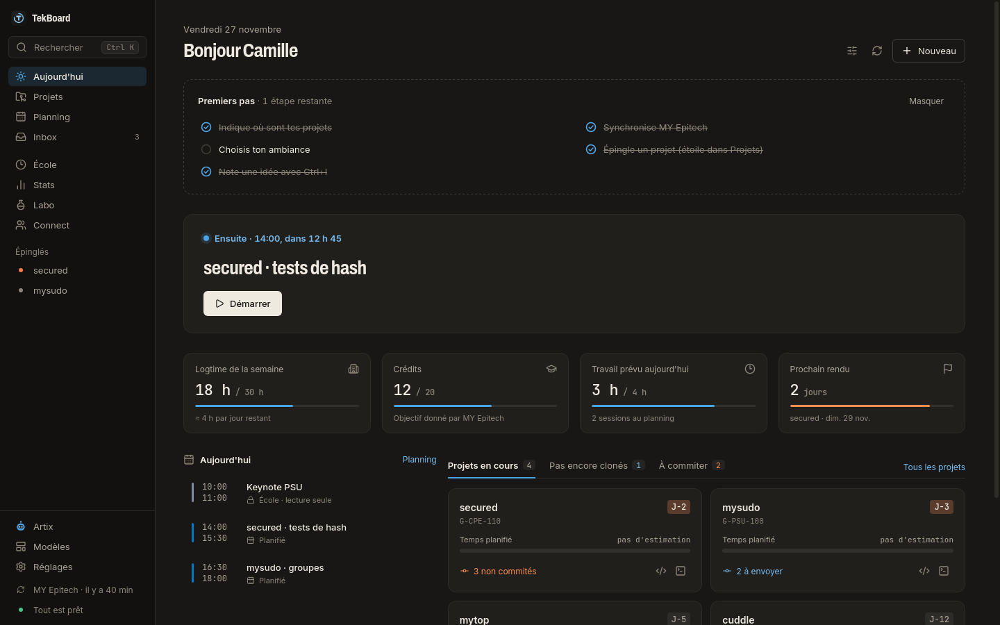
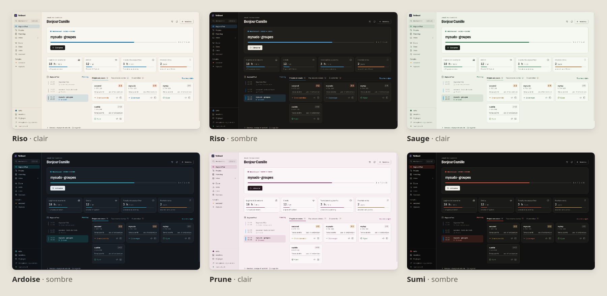
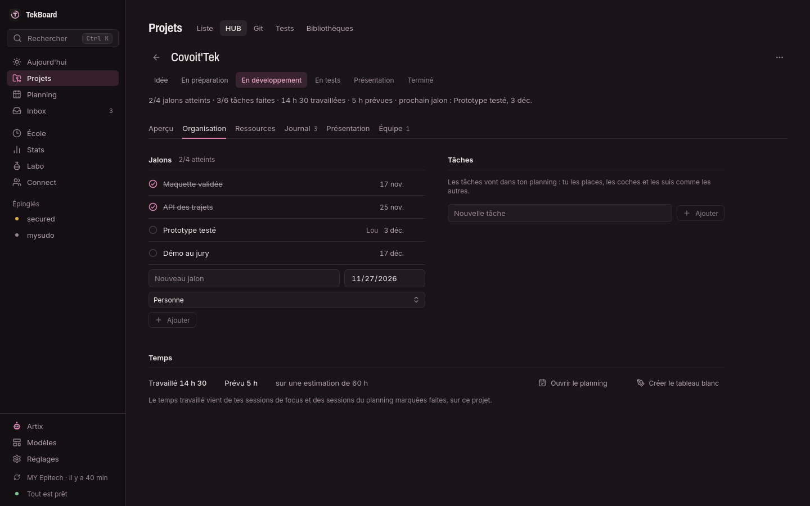
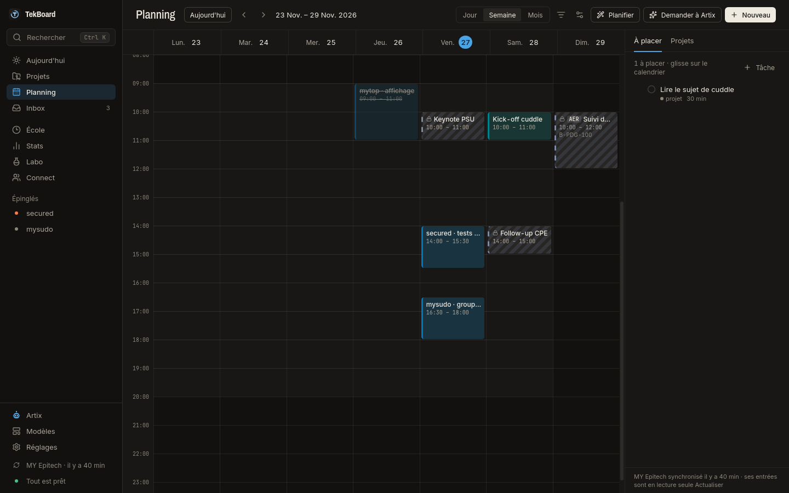
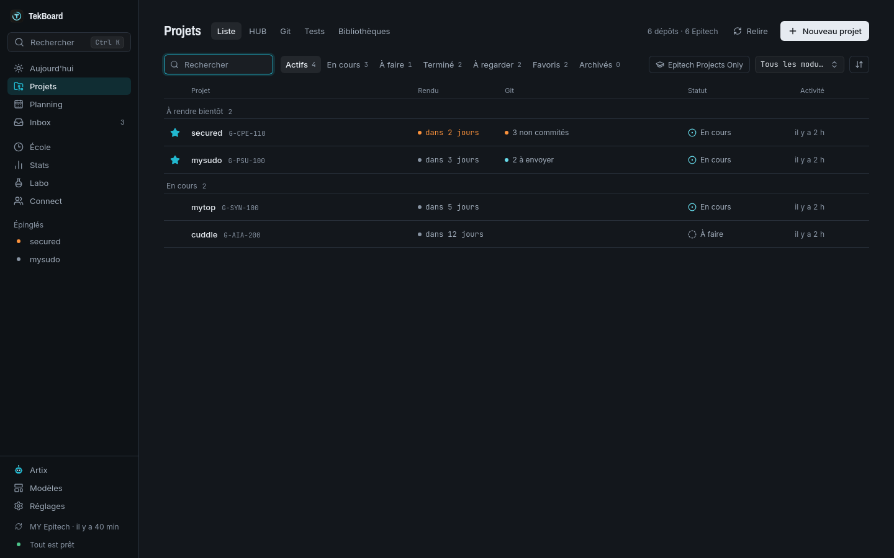
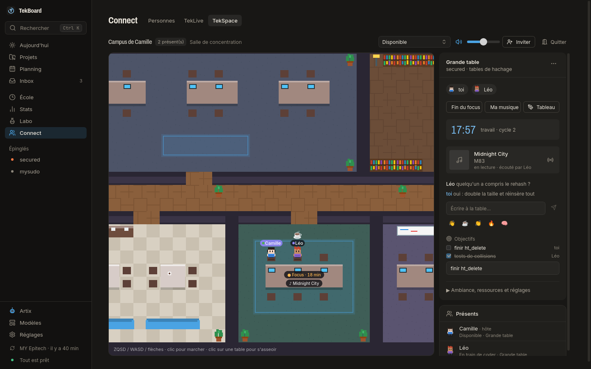

<p align="center"></p>

<h1 align="center">TekBoard</h1>

<p align="center">L'espace de travail de l'étudiant Epitech, sur Linux.<br/>Projets, rendus, planning, école, projets HUB et entraide, au même endroit.</p>

<p align="center"><a href="https://github.com/ar-oxyo/tekboard-desktop/releases/latest"><b>Télécharger la dernière version</b></a> · <a href="docs/GUIDE.md">Guide</a> · <a href="CHANGELOG.md">Nouveautés</a></p>

> **Projet personnel, non officiel.** TekBoard est développé seul par Thibault Eininger, étudiant à Epitech. Il n'est ni produit, ni validé, ni soutenu par Epitech. « Epitech », « MY Epitech » et les noms des modules appartiennent à leurs propriétaires ; TekBoard lit seulement, avec ton accord, les données de ton propre compte.



## Pour qui, pour quoi

Pour les étudiants Epitech qui veulent voir en un coup d'œil ce qui compte aujourd'hui, et travailler sans jongler entre dix outils.

- **Aujourd'hui** : ce qu'il faut faire maintenant, le logtime, les crédits, le prochain rendu.
- **Projets** : tous tes dépôts, leur état git et leurs rendus ; un rendu passé clôt le projet au lieu de le laisser « en retard ».
- **Projet HUB** : de l'idée à la présentation, avec jalons, tâches, ressources, journal, équipe et estimation de crédits.
- **Planning** : tes sessions de travail placées avec des pauses autour des cours, planifiables en groupe, agendas Student et AER réunis.
- **École** : MY Epitech en un bouton, logtime, simulateur de crédits, Skill Tree, sujets.
- **Artix** : un assistant qui organise, décompose et dessine sur les tableaux blancs, avec Claude Code, OpenRouter ou une IA locale, ou sans IA.
- **Labo et Connect** : Playground C, Arena, tableaux blancs, et TekSpace pour travailler à plusieurs sur le même réseau.

Le **mode allégé** et la **taille de l'interface** (Réglages → Apparence) adaptent TekBoard à ta façon de travailler. Tout reste sur ton ordinateur : pas de compte, pas de serveur, pas de télémétrie.



| | |
| --- | --- |
|  |  |
|  |  |

## Installer

```sh
curl -fsSL https://raw.githubusercontent.com/ar-oxyo/tekboard-desktop/main/install.sh | bash
```

Le script installe TekBoard (`.deb` sur Ubuntu/Debian, AppImage ailleurs) après avoir vérifié son empreinte, propose les outils utiles un par un et se relance sans risque. Installation à la main, systèmes compatibles et options : [guide d'installation](docs/GUIDE.md#installation).

## Lancer

Depuis le menu des applications, ou `tekboard` dans un terminal. Un court assistant te guide au premier lancement : langue et ambiance, outils, MY Epitech, dossiers de projets, IA. Chaque étape se passe.

## Documentation

- [Guide](docs/GUIDE.md) : prérequis, Connect, GitHub, IA, mises à jour, problèmes fréquents, tes données.
- [Architecture](docs/ARCHITECTURE.md) : modules, frontière de confiance, choix techniques.
- [Développer](docs/GUIDE.md#développer) : compiler, lancer les tests, publier une version.
- [Nouveautés](CHANGELOG.md) · [Sécurité](SECURITY.md)

## English

TekBoard is an independent personal project by an Epitech student, not affiliated with or endorsed by Epitech. It is a local-first desktop workspace for Epitech students on Linux: repositories and hand-ins, planning, MY Epitech sync (Student and AER accounts), a credits simulator, HUB projects, whiteboards, peer collaboration on the local network, and Artix, an AI assistant working through controlled tools (Claude Code, OpenRouter, Ollama, or no AI). Install it with the command above or from the [latest release](https://github.com/ar-oxyo/tekboard-desktop/releases/latest); the interface can be switched to English.

## Licence

[GPL-3.0](LICENSE) © 2026 Thibault Eininger.
