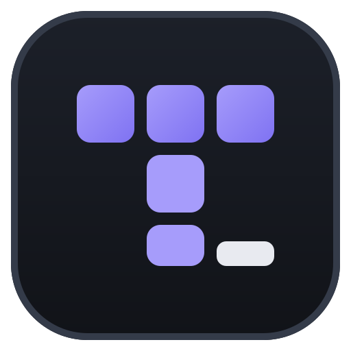

<p align="center"></p>

<h1 align="center">TekBoard</h1>

<p align="center">Ton tableau de bord d'étudiant Epitech, sur Linux.<br/>Tes projets, tes rendus, ton planning, ton logtime et Artix, un assistant qui agit pour toi.</p>

<p align="center"><a href="https://github.com/ar-oxyo/tekboard-desktop/releases/latest"><b>Télécharger la dernière version</b></a></p>

> **Projet personnel, non officiel.** TekBoard est une application que je développe seul, dans mon coin : Thibault Eininger, étudiant à Epitech. Elle n'est ni produite, ni validée, ni soutenue par Epitech, et n'a aucun lien avec l'école. « Epitech », « MY Epitech » et les noms des modules appartiennent à leurs propriétaires ; TekBoard ne fait que lire, avec ton accord, les données de ton propre compte.


## Ce que fait Tekboard

- **Projets** : tous tes dépôts Epitech au même endroit, même rangés dans des sous-dossiers (`Epitech/Maths/101pong`…), avec leur état git, leur date de rendu et ce qu'il reste à faire. Les copies en double sont repérées, jamais supprimées.
- **Planning** : un calendrier qui place tes sessions de travail avec des pauses, des catégories à toi, et les rendus de l'école.
- **École** : synchronisation MY Epitech en un bouton (projets, dates, sujets, résultats), **logtime** de la semaine, et le **Skill Tree** : ta progression en arbre de compétences, d'après les données officielles de MY Epitech.
- **Tests** : tests unitaires, coding style (Banana), clone propre du dépôt, et une moulinette simulée dans un bac à sable.
- **Artix** : un assistant qui comprend « j'ai un rendez-vous jeudi à 14 h » et l'ajoute, décompose un sujet en tâches, organise ta semaine. Il fonctionne avec **Claude Code, OpenRouter (modèles gratuits) ou une IA locale** — ou pas d'IA du tout.
- **Doctor** : un diagnostic de ton environnement, avec la solution à chaque problème.

Tout reste sur ton ordinateur : pas de compte TekBoard, pas de serveur, pas de télémétrie.

| | |
| --- | --- |
|  |  |
|  |  |

## Installation rapide

Dans un terminal :

```sh
curl -fsSL https://raw.githubusercontent.com/ar-oxyo/tekboard-desktop/main/install.sh | bash
```

C'est tout. Le script :

1. détecte ton système et ce qui est déjà installé (rien n'est réinstallé inutilement) ;
2. installe TekBoard (paquet `.deb` sur Ubuntu/Debian, AppImage ailleurs) après avoir vérifié son empreinte SHA-256 ;
3. installe les outils obligatoires qui manquent, puis te **propose** les outils optionnels un par un ;
4. t'aide à connecter GitHub (`gh auth login`) et à choisir une IA ;
5. affiche un résumé : ce qui est prêt, ce qui manque et la commande pour le corriger.

Tu peux le relancer quand tu veux : il reprend là où il s'est arrêté. Il demande ton mot de passe uniquement pour installer des paquets système, et le dit avant.

<details>
<summary>Options du script</summary>

| Option | Effet |
| --- | --- |
| `--minimal` | seulement TekBoard et ses dépendances obligatoires |
| `--yes` | répond oui à toutes les questions |
| `--dry-run` | montre ce qui serait fait, sans rien installer |
| `--dev` | compile TekBoard depuis un clone du dépôt |
| `--uninstall` | désinstalle TekBoard (tes données sont gardées) |

Pour lire le script avant de le lancer : `curl -fsSLO https://raw.githubusercontent.com/ar-oxyo/tekboard-desktop/main/install.sh && less install.sh && bash install.sh`.
</details>

### Systèmes compatibles

| Système | Installation | Notes |
| --- | --- | --- |
| Ubuntu 22.04+, Linux Mint, Pop!_OS | `.deb` | epiclang et Banana installés depuis le PPA officiel d'Epitech |
| Debian 12+ | `.deb` | epiclang : à installer à la main (publié pour Ubuntu seulement) |
| Fedora | AppImage | paquets via `dnf` |
| Arch, Manjaro | AppImage | paquets via `pacman` |
| Autres distributions x86_64 | AppImage | il faut WebKitGTK 4.1 et FUSE 2 |
| macOS, Windows, ARM | — | non pris en charge (sous Windows, utilise WSL 2 avec Ubuntu) |

<details>
<summary>Installer à la main, sans le script</summary>

- **Ubuntu/Debian** : télécharge `TekBoard_<version>_amd64.deb` depuis la [dernière version](https://github.com/ar-oxyo/tekboard-desktop/releases/latest), double-clique dessus puis **Installer** (ou `sudo apt install ./TekBoard_*_amd64.deb`).
- **Autres** : télécharge `TekBoard_<version>_amd64.AppImage`, rends-le exécutable (`chmod +x TekBoard_*.AppImage`) et lance-le.
- **Vérifier le téléchargement** : `sha256sum -c SHA256SUMS --ignore-missing`, et `gh attestation verify TekBoard_*_amd64.deb -R ar-oxyo/tekboard-desktop`.
</details>

## Prérequis

Le script s'en occupe ; voici le détail pour savoir à quoi sert chaque outil.

| Outil | Statut | Sert à |
| --- | --- | --- |
| `git`, `ssh`, `make` | **obligatoire** | lister et cloner tes dépôts, compiler tes projets |
| WebKitGTK 4.1 | **obligatoire** | afficher l'application (fourni avec le `.deb`) |
| `gh` (GitHub CLI) | optionnel | liste de tes dépôts GitHub, clonage depuis TekBoard |
| `epiclang`, `banana-check-repo` | optionnel | vérification du coding style (tuile Banana) |
| `gcc`, `valgrind`, `gdb`, `gcovr` | optionnel | compilation, fuites mémoire, débogage, couverture |
| `pdftotext` (poppler) | optionnel | lecture des sujets PDF par l'IA |
| `bubblewrap` | optionnel | bac à sable de la moulinette d'Artix et de la génération de tests |
| Claude Code, OpenRouter ou Ollama | optionnel | Artix (voir [Intelligence artificielle](#intelligence-artificielle)) |
| Node.js 20+, Rust, bibliothèques `-dev` | développement | seulement pour compiler TekBoard (`./install.sh --dev`) |

Un outil absent ne bloque jamais TekBoard : la fonction concernée est désactivée et l'application explique pourquoi et comment l'installer (**Réglages → Doctor**).

## Configuration GitHub

TekBoard utilise ta configuration git existante : il ne stocke aucun jeton GitHub.

```sh
gh auth login            # se connecter (navigateur), une seule fois
ssh -T git@github.com    # vérifier que ta clé SSH est acceptée
```

Le script d'installation propose `gh auth login` s'il n'est pas déjà fait. Dans TekBoard, **Réglages → Doctor** montre l'état de GitHub CLI, de ton identité git et de ton agent SSH.

## Intelligence artificielle

Artix, l'assistant de TekBoard, peut utiliser l'une de ces trois IA. Le choix se fait au premier lancement ou dans **Réglages → Artix (IA)**, et se change à tout moment.

| | Claude Code | OpenRouter | IA locale (Ollama) |
| --- | --- | --- | --- |
| Coût | ton abonnement Claude | **gratuit** (modèles gratuits) | **gratuit** |
| Installation | `curl -fsSL https://claude.ai/install.sh \| bash` puis `claude` | rien : une clé sur [openrouter.ai/keys](https://openrouter.ai/keys) | `curl -fsSL https://ollama.com/install.sh \| sh` |
| Tes données | envoyées à Anthropic | envoyées à OpenRouter et à l'hébergeur du modèle | **restent sur ton ordinateur** |
| Conversation avec Artix, planning | ✅ | ✅ | ✅ |
| Lecture des sujets, analyse de projet, README | ✅ | ✅ | ✅ |
| Moulinette d'Artix, génération de tests (agents) | ✅ | — | — |

- **OpenRouter** : colle ta clé dans TekBoard ; il te propose les meilleurs modèles gratuits et un bouton **Tester la connexion**. TekBoard **n'utilise jamais un modèle payant sans ton accord explicite**, même si un modèle gratuit le devient. La clé est gardée dans un fichier lisible par toi seul et n'apparaît jamais dans les journaux.
- **Ollama** : TekBoard détecte les modèles installés et te recommande celui qui convient à ta mémoire (de `qwen2.5:1.5b` à `qwen2.5:14b`), avec un bouton pour le télécharger.
- **Les agents** (moulinette d'Artix, génération de tests) modifient des fichiers et lancent des commandes dans un bac à sable : ils restent réservés à Claude Code, et TekBoard le dit clairement avec les autres IA.
- **Sans IA** : tout le reste de TekBoard fonctionne, y compris les plannings automatiques (`#day`, `#week`).

## Lancer TekBoard

Depuis le menu des applications, ou avec la commande `tekboard`. Au premier lancement, un court assistant te guide (chaque étape facultative se passe) :

1. **Langue et apparence** (français ou anglais, cinq designs).
2. **Ton environnement** : TekBoard vérifie les outils et explique ce qui manque.
3. **MY Epitech** : tu te connectes sur le vrai site, dans une fenêtre à part. TekBoard ne voit jamais ton mot de passe.
4. **Tes dossiers de projets** : TekBoard trouve les dépôts git qu'ils contiennent, sous-dossiers compris. Il ne déplace ni ne modifie rien.
5. **Ton IA** : Claude Code, OpenRouter, Ollama, ou aucune.

Tu peux fermer TekBoard au milieu : il reprend à la même étape. L'assistant se relance depuis **Réglages → Général**.

## Mettre à jour

TekBoard cherche lui-même une nouvelle version une fois par jour au plus et te prévient. Tu peux aussi aller dans **Réglages → Mises à jour**, ou relancer le script d'installation (il ne remplace que TekBoard, et seulement s'il existe une version plus récente).

Chaque paquet est signé : TekBoard refuse un fichier dont la signature ne correspond pas. Tes données et tes réglages sont conservés : une installation 0.6 passe en 0.7 en gardant Claude Code comme IA si elle l'utilisait.

## Désinstaller

```sh
curl -fsSL https://raw.githubusercontent.com/ar-oxyo/tekboard-desktop/main/install.sh | bash -s -- --uninstall
```

ou `sudo apt remove tek-board` (paquet .deb), ou supprime `~/.local/bin/tekboard` (AppImage). Désinstaller **garde tes données** : le script te demande si tu veux aussi les effacer. Tes dépôts et tes dossiers de projets ne sont jamais touchés.

## Problèmes fréquents

**Commence par Réglages → Doctor** : il vérifie tout (outils, GitHub, MY Epitech, IA, base de données, dossiers, mises à jour), répare ce qui peut l'être sans risque et exporte un rapport **anonymisé** à joindre à un ticket.

<details>
<summary>« Claude Code est introuvable » alors qu'il marche dans mon terminal</summary>

Une application lancée depuis le bureau ne reçoit pas le PATH de ton shell. TekBoard cherche aussi dans les dossiers habituels ; sinon, indique le chemin de `claude` dans **Réglages → Artix (IA) → Claude Code**. Ou choisis OpenRouter / Ollama.
</details>

<details>
<summary>OpenRouter : « limite le nombre de requêtes »</summary>

Les modèles gratuits sont limités à une vingtaine de requêtes par minute. Attends un peu, ou choisis un autre modèle gratuit.
</details>

<details>
<summary>Ollama ne répond pas</summary>

Lance le service : `ollama serve` (ou `sudo systemctl start ollama`), puis **Revérifier** dans Réglages → Artix (IA).
</details>

<details>
<summary>Mes projets n'apparaissent pas</summary>

Ajoute le dossier qui les contient dans **Réglages → Général** : TekBoard cherche les dépôts git jusqu'à 8 niveaux de sous-dossiers et ignore `node_modules`, `target`, les caches et les dossiers cachés. Un dossier qui contient un `.git` vide ou incomplet n'est pas un dépôt.
</details>

<details>
<summary>L'AppImage ne se lance pas</summary>

Il manque souvent FUSE 2 : `sudo apt install libfuse2t64` (Ubuntu 24.04+), `sudo dnf install fuse-libs`, `sudo pacman -S fuse2`. Relancer `./install.sh` l'installe pour toi.
</details>

<details>
<summary>La tuile Banana est grisée</summary>

epiclang et banana-check-repo manquent. Sur Ubuntu : `sudo add-apt-repository ppa:epitech/ppa && sudo apt install epiclang banana-coding-style-checker`.
</details>

## Tes données

| Quoi | Où |
| --- | --- |
| Réglages, projets suivis, planning, tâches, notes | `~/.local/share/dev.tekboard.app/tekboard.db` |
| Clé OpenRouter (si tu en utilises une) | `~/.local/share/dev.tekboard.app/secrets.json` (lisible par toi seul) |
| Sujets téléchargés, modèles, bibliothèques | `~/.local/share/dev.tekboard.app/` |
| Session MY Epitech (cookies du site) | `~/.local/share/dev.tekboard.app/my-session/` |
| Fichiers temporaires | `~/.cache/dev.tekboard.app/` |

**Réglages → Données** permet d'ouvrir ces dossiers, d'**exporter** une sauvegarde (.zip), de la **restaurer** sur un autre ordinateur, de vider le cache et de réinitialiser. La sauvegarde ne contient ni la session MY Epitech, ni la clé OpenRouter, ni aucun mot de passe. Voir aussi [SECURITY.md](SECURITY.md).

## Signaler un bug

[Ouvre un ticket](https://github.com/ar-oxyo/tekboard-desktop/issues/new/choose) et joins le rapport de **Réglages → Doctor → Exporter le rapport** (il est anonymisé : relis-le quand même). Une faille de sécurité se signale en privé : voir [SECURITY.md](SECURITY.md).

## Développer

```sh
git clone https://github.com/ar-oxyo/tekboard-desktop.git && cd tekboard-desktop
./install.sh --dev   # Rust, Node.js et bibliothèques de Tauri, puis compilation et installation du .deb
npm run app:dev      # application avec rechargement à chaud
npm test             # tests du frontend
npm run test:rust    # tests du backend
scripts/tests/install_test.sh   # tests du script d'installation (systèmes simulés)
```

L'architecture est décrite dans [docs/ARCHITECTURE.md](docs/ARCHITECTURE.md).

**Publier une version** (mainteneurs) : mets la version à jour dans `package.json`, `src-tauri/Cargo.toml` et `src-tauri/tauri.conf.json`, ajoute sa section dans [CHANGELOG.md](CHANGELOG.md) (`npm run release:check` vérifie le tout), puis pousse un tag `vX.Y.Z`. Le workflow `release.yml` compile, signe et prépare une release **brouillon** ; elle n'est visible des utilisateurs qu'une fois publiée à la main. Les secrets `TAURI_SIGNING_PRIVATE_KEY` et `TAURI_SIGNING_PRIVATE_KEY_PASSWORD` doivent être définis dans le dépôt.

## English

TekBoard is an independent personal project by Thibault Eininger, an Epitech student — not an official Epitech product and not affiliated with or endorsed by Epitech. It is a local-first desktop dashboard for Epitech students on Linux: repositories, hand-ins, planning, weekly logtime, MY Epitech sync and Artix, an AI assistant that acts through controlled tools. Install it with one command — `curl -fsSL https://raw.githubusercontent.com/ar-oxyo/tekboard-desktop/main/install.sh | bash` — or download the `.deb` (Ubuntu/Debian) or the AppImage from the [latest release](https://github.com/ar-oxyo/tekboard-desktop/releases/latest). Artix works with Claude Code, OpenRouter (free models, never a paid one without your consent) or a local model through Ollama, or without AI at all. The interface can be switched to English during the first-run setup or in Settings.

## Licence

[GPL-3.0](LICENSE) © 2026 Thibault Eininger.

TekBoard est un projet personnel et indépendant. Ce n'est pas un produit officiel d'Epitech, et Epitech n'y est associée d'aucune façon.
